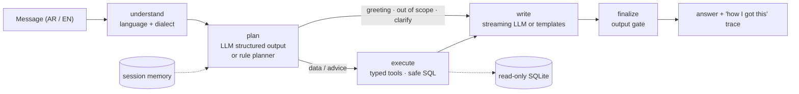

# Bilingual Market Assistant

[](https://github.com/accnadashaban-png/bilingual-market-assistant/actions/workflows/ci.yml)
 

A ChatGPT-style assistant that answers stock-market questions in **Arabic (Egyptian, Gulf, Levantine, MSA) and English**, straight from a database. It plans with typed tools, runs only safe read-only SQL, streams natural answers, remembers the conversation, and plugs into any dashboard as a chat widget with one `<script>` tag.


> A public, from-scratch rebuild of the kind of assistant I work on professionally, on **fictional companies and synthetic prices** so the code can be shared. No real market data, company data or employer code.

## Highlights

| | |
|---|---|
| **Natural answers** | Lead with the answer, then the detail. A sentence for one fact, bullets for a few, a table for comparisons. Streams token by token. In LLM mode it replies in the user's dialect; offline templates reply in Egyptian Arabic, MSA or English. |
| **Understands follow-ups** | "Top gainers in Egypt this week" → "and in Saudi?", or "سهم النيل للاتصالات بكام؟" → "وأداؤه من أول السنة؟". Conversation memory per session. |
| **Typed tools, not free-form SQL** | 12 Pydantic-validated tools (quotes, performance, movers, sectors, compare, screener, technical signals, fundamentals, market breadth...) with bound parameters. Free SQL is only a validated fallback. |
| **Defense in depth** | sqlglot AST validation, read-only connection, SQLite authorizer, query time limit, row cap, output gate. 40+ red-team tests, including a *compromised model* that returns malicious plans. |
| **LangGraph pipeline** | `understand → plan → execute → write → finalize`, with structured-output planning, one repair round, self-healing SQL and graceful fallback when the LLM is down. |
| **Measured, not guessed** | Golden dataset of 47 multi-dialect cases. Expected numbers are recomputed from the database at run time. CI fails below 95%. |
| **Production basics** | FastAPI + SSE streaming, rate limiting, request IDs in JSON logs, Prometheus metrics, health/readiness checks, Docker, GitHub Actions (lint, types, tests, eval, secrets scan, image smoke test). |
| **Runs offline** | No API key? A rule-based planner and template writer handle all of the above, so the demo, tests and eval run anywhere. Add any OpenAI-compatible key for full LLM mode. |

## How it works



| Route | Example | What happens |
|---|---|---|
| data | "سهم النيل للاتصالات بكام؟" | Tool call, then a one-sentence Egyptian Arabic answer with price, change and 52-week range |
| data | "Compare ATLS and NOVC over 3 months" | `compare` tool, then a lead line and a table |
| advice | "Should I buy Tuwaiq?" | Explains it gives information, not advice, then shows the facts |
| out of scope | "Bitcoin price?", "Predict ATLS next month" | Says what it can answer instead |
| blocked | "Delete all companies", prompt injection | Refused, nothing reaches the database |

## Safety layers

1. **Typed tools:** user text only ever reaches SQL as a bound parameter; arguments are validated by Pydantic (tickers must exist, periods and countries are enums).
2. **sqlglot validator** (`run_sql` fallback): one statement, `SELECT` only, no comments, no `SELECT *`, no recursive CTEs, known tables only, no unsafe functions, automatic `LIMIT`.
3. **Read-only connection:** SQLite opened with `mode=ro`.
4. **Authorizer:** the database itself refuses anything but reading the allowed tables, even if layer 2 were bypassed.
5. **Time limit and row cap** on every query.
6. **Output gate:** strips SQL, raw rows, IDs and code from replies; adds the disclaimer to advice answers.
7. **API limits:** input size, session-id size, per-client rate limit, safe error messages in the user's language.

`tests/test_redteam.py` attacks all of these: injected instructions in Arabic and English, stacked queries, `sqlite_master`, `ATTACH`, `load_extension`, recursive CTEs, a model that leaks SQL in its answer, a model that invents a `shell` tool, and direct API abuse. After every attack it checks that the database is unchanged and nothing internal leaked.

## Evaluation

```bash
python eval/run_eval.py
```

Latest offline run ([full report](eval/reports/latest.md)):

| Metric | Score |
|---|---|
| Overall (47 cases) | **100%** |
| Route accuracy | 100% |
| Tool accuracy | 100% |
| Fact accuracy (numbers recomputed from the DB) | 100% |
| Answer language matches question | 100% |

Cases cover quotes, performance, movers, sectors, comparisons, screens, signals, fundamentals, market breadth, multi-turn follow-ups, greetings, advice, out-of-scope questions and safety, across English, Egyptian, Gulf, Levantine and MSA. With an LLM configured, the same command evaluates the model-driven pipeline.

## Quick start

```bash
pip install -e ".[dev]"
python data/generate.py                 # builds data/market.db
uvicorn market_assistant.api:app        # dashboard + widget on http://127.0.0.1:8000
python -m market_assistant "Top gainers in Egypt this week"
pytest                                  # 91 tests
```

Or with Docker: `docker build -t bilingual-market-assistant . && docker run -p 8000:8000 bilingual-market-assistant`

**LLM mode:** copy `.env.example` to `.env` and set `MA_LLM_API_KEY` (any OpenAI-compatible endpoint; the default is Gemini's).

**Embed the widget in your own dashboard:**

```html
<script src="https://your-host/static/widget.js" data-api="https://your-host" defer></script>
```

It runs inside a Shadow DOM (no CSS clashes), renders Markdown safely (escaped first), switches RTL/LTR per message and keeps the session in `sessionStorage`.

## API

| Method | Path | Purpose |
|---|---|---|
| POST | `/v1/ask` | Ask a question → answer, route, tool calls, session id |
| POST | `/v1/ask/stream` | Same, as Server-Sent Events: `meta`, `delta`..., `final` |
| GET | `/v1/tools` | Tool names, descriptions and JSON schemas |
| POST | `/v1/tools/{name}` | Call a tool directly (validated) |
| GET | `/v1/market/snapshot` | Latest quotes for the dashboard |
| GET | `/health`, `/ready`, `/metrics` | Liveness, readiness, Prometheus metrics |

## Project layout

```
market_assistant/
  pipeline.py      LangGraph graph, sessions, streaming
  planner.py       LLM planner (structured output + repair) and multi-dialect rule planner
  tools.py         12 typed tools with bound-parameter SQL
  sql_safety.py    sqlglot validator
  database.py      read-only connection, authorizer, time limit
  writer.py        answer shapes, LLM writer, output gate
  language.py      language, dialect, Arabic normalization
  llm.py           OpenAI-compatible client with streaming
  api.py           FastAPI app, rate limiting, request IDs
  observability.py JSON logs and Prometheus metrics
web/               demo dashboard + embeddable widget
data/generate.py   fictional companies, synthetic prices, indicators and signals
eval/              golden dataset + evaluation runner
tests/             91 tests: safety, tools, planner, pipeline (with a fake LLM), API, red-team
```

## About the data

`data/generate.py` creates 30 **fictional** companies across the US, Saudi Arabia and Egypt, 320 trading days of synthetic prices from a seeded random walk, and computes moving averages, RSI(14), 52-week ranges, technical signals and three years of fundamentals. Tickers are made up; any match with a real listing is a coincidence.

## Related

- [arabic-chatbot-eval](https://github.com/accnadashaban-png/arabic-chatbot-eval): how I test chatbots like this one before launch
- [Case study: AI trading assistant](https://github.com/accnadashaban-png/work-case-studies#1-ai-trading-assistant)

---

Built by [Nada Shaban](https://nadashaaban.com) · MIT License
