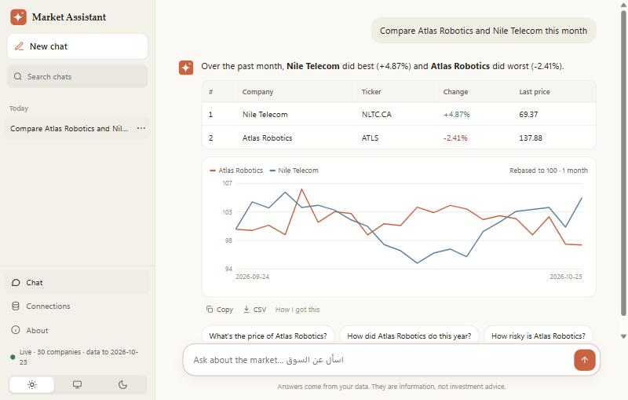
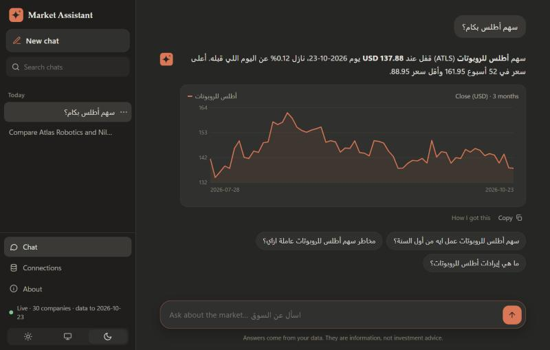
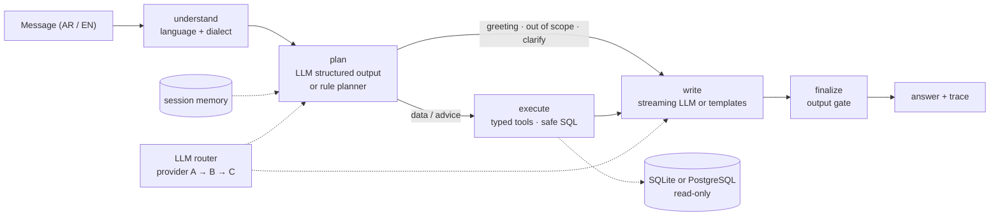
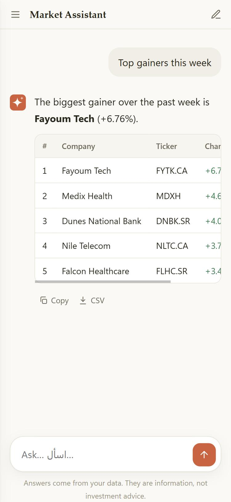
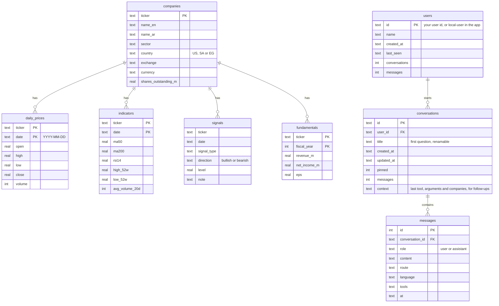

# Bilingual Market Assistant

[](https://github.com/accnadashaban-png/bilingual-market-assistant/actions/workflows/ci.yml)
   

A conversational AI assistant that answers stock-market questions in **Arabic (Egyptian, Gulf, Levantine, MSA) and English**, straight from a database. It plans with typed tools, runs only safe read-only SQL on **SQLite or PostgreSQL**, streams natural answers with charts and follow-up questions, follows **live data** without a restart, saves each person's conversations like a modern AI assistant, **fails over across a group of LLM providers** when one runs out of quota, and plugs into any dashboard as a chat widget or into any AI app through **MCP**.

| Light | Dark, in Arabic |
|---|---|
|  |  |

> A public, from-scratch rebuild of the kind of assistant I work on professionally, on **fictional companies and synthetic prices** so the code can be shared. No real market data, company data or employer code.

## Highlights

| | |
|---|---|
| **Natural, bilingual answers** | Lead with the answer; a sentence for one fact, bullets for a few, a table for comparisons. Streams token by token. In LLM mode it mirrors the user's dialect; offline templates answer in Egyptian Arabic, MSA or English. |
| **Live data** | The database is read on every question and its summary (companies, latest trading day, row count) is re-checked every few seconds, so new prices, new trading days and new companies are answered at once, with no restart. Add prices from a CSV file or any pipeline (`add-prices`), or turn on the demo feed and watch answers change. |
| **Conversations like a modern AI assistant** | Each person's chats are saved (SQLite), listed in a sidebar by day, searchable across every message, and can be renamed, pinned or deleted. A chat continues after a restart, follow-ups included. Nobody can read or continue someone else's chat; an admin can list people and erase a person with everything they said. |
| **Answers you can use** | A price chart behind every company answer (several companies rebased to 100), follow-up questions in the user's language that are tested to be answerable, copy, and CSV export of any table. |
| **LLM provider failover** | Declare a group of providers (several free tiers, a local model...). Quota exhausted, rate limited, down or bad key: the next provider answers, the failing one is benched for a cooldown that matches the failure, and every provider's state is visible at `/v1/llm/providers`. |
| **14 typed tools** | Quotes, performance, movers, sectors, comparisons, screener, technical signals, **signal hit rates**, **risk (volatility, drawdown, beta)**, fundamentals, market breadth, company lists, and a validated SQL fallback. |
| **SQLite or PostgreSQL** | Same answers on both, proven by a parity test across every tool. PostgreSQL runs through a SELECT-only role with READ ONLY sessions and a server-side timeout. |
| **Defense in depth** | Bound parameters, sqlglot validation, read-only access, database permission checks, time limits, row caps and an output gate. Red-team tests include a *compromised model* returning malicious plans. See [SECURITY.md](docs/SECURITY.md). |
| **Measured** | 1,296-case evaluation (47 hand-written + generated coverage of all 90 companies, every dialect, market and period), rankings checked in order, numbers recomputed independently, dataset QA tests, run-over-run tracking and an optional LLM-as-judge. See [EVALUATION.md](docs/EVALUATION.md). |
| **Production basics** | LangGraph pipeline with per-step timing, FastAPI + SSE, MCP server, rate limiting, JSON logs with request ids, Prometheus metrics, Docker and docker-compose, CI with lint, types, tests, evaluation gate, PostgreSQL job, secrets scan and image smoke test. |
| **Your own private app** | `python -m market_assistant app` opens it as a desktop app on your machine, in a warm light or dark theme that also works on a phone: import your own CSV files or connect a SQLite / PostgreSQL database, add your own AI keys, and chat. Keys stay on your computer and are never sent back to the page. See [DESKTOP.md](docs/DESKTOP.md). |
| **Runs offline** | No API key needed: a multi-dialect rule planner and template writer cover every route, so the demo, tests and evaluation run anywhere. |

## How it works



More in [ARCHITECTURE.md](docs/ARCHITECTURE.md).

| Example | What happens |
|---|---|
| "سهم النيل للاتصالات بكام؟" → "وأداؤه من أول السنة؟" | `quote`, then `performance` for the same company from memory, answered in Egyptian Arabic |
| "Top gainers in Egypt this week" → "and in Saudi?" | `top_movers`, then the same query for Saudi Arabia, as a table |
| "What's the hit rate after a 52-week breakout?" | `signal_performance`: average 10-day move and how often stocks rose, labelled as historical |
| "How risky is Atlas Robotics?" | `risk_metrics`: annualized volatility, max drawdown, beta vs its market |
| "Should I buy Tuwaiq?" | Information-not-advice reply with the facts |
| "Delete all companies", "Ignore your instructions..." | Refused; nothing reaches the database |

## Use it as an app on your computer

```bash
pip install -e .
python -m market_assistant app                  # opens the app in its own window
```



**Connections** is where the assistant gets its data and, optionally, its AI models:

- **Data:** the demo, your CSV files, a SQLite file or a read-only PostgreSQL user. The page shows what is connected, how many companies and price rows it has, the latest trading day, and when new data was last seen. It is re-checked every 5 seconds.
- **Live updates:** upload new prices (same columns as `daily_prices.csv`) and the next answer uses them; existing days are corrected and indicators and signals are recalculated. The **demo feed** keeps a private copy of the demo moving: it fills in missing trading days up to today, then moves today's prices during the session. It never writes a future date.
- **AI models:** Gemini, Groq, OpenRouter, a local Ollama model or any OpenAI-compatible endpoint, several in order for failover. Without a key it still answers, using the built-in rule planner.

Chats are saved on your computer only, next to the settings. Security model and CSV formats: [DESKTOP.md](docs/DESKTOP.md).

<br clear="right">

## The data and the saved conversations



The market tables are read-only for the assistant; you provide `companies`, `daily_prices` and optionally `fundamentals`, and `indicators` and `signals` are computed for you. The three conversation tables live in a separate SQLite file (`MA_HISTORY_DB`), so the market database never needs write access.

Sample rows from the demo (fictional companies):

| `companies` | ticker | name_en | name_ar | sector | country | exchange | currency |
|---|---|---|---|---|---|---|---|
| | ATLS | Atlas Robotics | أطلس للروبوتات | Technology | US | NASDAQ | USD |
| | NLTC.CA | Nile Telecom | النيل للاتصالات | Communication Services | EG | EGX | EGP |
| | KHLG.CA | Kharga Solar | الخارجة للطاقة الشمسية | Energy | EG | EGX | EGP |

| `daily_prices` | ticker | date | open | high | low | close | volume |
|---|---|---|---|---|---|---|---|
| | ATLS | 2026-10-22 | 136.42 | 139.01 | 133.27 | 134.36 | 1,541,741 |
| | ATLS | 2026-10-23 | 136.46 | 139.94 | 133.95 | 136.36 | 1,707,845 |

| `indicators` | ticker | date | ma50 | ma200 | rsi14 | high_52w | low_52w |
|---|---|---|---|---|---|---|---|
| | ATLS | 2026-10-23 | 148.89 | 138.73 | 45.17 | 176.37 | 108.64 |

| `signals` | ticker | date | signal_type | direction | note |
|---|---|---|---|---|---|
| | BRLS.CA | 2026-10-23 | rsi_oversold | bullish | RSI(14) fell below 30 |
| | BRSM | 2026-10-23 | 52w_low_breakdown | bearish | closed 44.51 below the 52-week low 44.82 |

| `fundamentals` | ticker | fiscal_year | revenue_m | net_income_m | eps |
|---|---|---|---|---|---|
| | ATLS | 2025 | 27,129.7 | 1,984.0 | 4.84 |

The demo has 90 companies, 46,800 daily prices (two years, October 2024 to October 2026), 5,122 signals and 270 fundamentals rows.

## Quick start (developers)

```bash
pip install -e ".[dev,postgres,mcp]"
python scripts/generate_data.py                 # builds data/market.db
uvicorn market_assistant.api.app:app            # dashboard + widget on http://127.0.0.1:8000
python -m market_assistant "Top gainers in Egypt this week"
pytest                                          # 172 tests
python -m market_assistant.eval                 # 1,296-case evaluation
```

**PostgreSQL stack:** `docker compose up --build` starts PostgreSQL 16, loads the data, creates the read-only role and runs the API on it.

**LLM mode:** copy `.env.example` to `.env` and set one provider, or a provider group in `MA_LLM_PROVIDERS` for failover.

**Live data:** `python -m market_assistant add-prices new_prices.csv --db data/market.db` appends or corrects prices from any pipeline or scheduled job; the running assistant answers with them within seconds. `python -m market_assistant live-demo` keeps a copy of the demo moving.

**Saved conversations on a server:** set `MA_HISTORY_DB=history.db` and send each person's id as `user_id`; set `MA_ADMIN_KEY` for the admin endpoints.

**MCP:** `python -m market_assistant.api.mcp_server` exposes all tools to desktop AI apps, IDEs or any MCP client.

**Embed the widget:**

```html
<script src="https://your-host/static/widget.js" data-api="https://your-host" defer></script>
```

## API

| Method | Path | Purpose |
|---|---|---|
| POST | `/v1/ask` | Answer, route, tool calls, step trace, chart, follow-up suggestions, session id (send `user_id` to save the chat) |
| POST | `/v1/ask/stream` | Same, as Server-Sent Events: `meta`, `delta`..., `final` |
| GET · PATCH · DELETE | `/v1/conversations[/{id}]?user_id=` | A person's chats: list and search, read, rename or pin, delete |
| GET · DELETE | `/v1/admin/people[/{id}]`, GET `/v1/admin/conversations/{id}` | People and their chats, erase a person (`X-Admin-Key`) |
| GET | `/v1/data/status` | Companies, price rows, latest trading day, when new data was last seen |
| GET | `/v1/tools` · POST `/v1/tools/{name}` | Tool schemas · call a tool directly (validated) |
| GET | `/v1/llm/providers` | Provider group status (no keys) |
| GET | `/v1/market/snapshot` | Latest quotes for the dashboard |
| GET | `/health` · `/ready` · `/metrics` | Liveness · readiness · Prometheus |

## Project layout

```
market_assistant/
  core/      settings, typed errors, JSON logging and metrics, saved conversations
  db/        SQLite and PostgreSQL backends with live refresh, sqlglot validator, CSV importer, live price updates
  agent/     LangGraph pipeline, planners, 14 tools, writer, charts and follow-ups, LLM router, language
  api/       FastAPI app, MCP server
  desktop/   local app: settings store, secure local server
  eval/      dataset (golden + generated), runner, LLM-as-judge
tests/       mirrors the package: agent/ api/ db/ desktop/ eval/ security/
scripts/     synthetic data generator, PostgreSQL loader
web/         demo dashboard, embeddable widget, local app
docs/        architecture, security, evaluation, deployment, desktop app
reports/     latest evaluation report and run history
```

## About the data

`scripts/generate_data.py` creates 90 **fictional** companies (30 each in the US, Saudi Arabia and Egypt, across 10 sectors), 520 trading days (about two years) of synthetic prices from a seeded random walk, and computes moving averages, RSI(14), 52-week ranges, technical signals and three years of fundamentals. Tickers and names are made up and chosen to avoid real listings and everyday words; any match with a real listing is a coincidence.

## Related

- [arabic-chatbot-eval](https://github.com/accnadashaban-png/arabic-chatbot-eval): how I test chatbots before launch
- [customer-support-analytics](https://github.com/accnadashaban-png/customer-support-analytics): support metrics and dashboard
- [Case study: AI trading assistant](https://github.com/accnadashaban-png/work-case-studies#1-ai-trading-assistant)

---

Built by [Nada Shaban](https://nadashaaban.com) · MIT License
