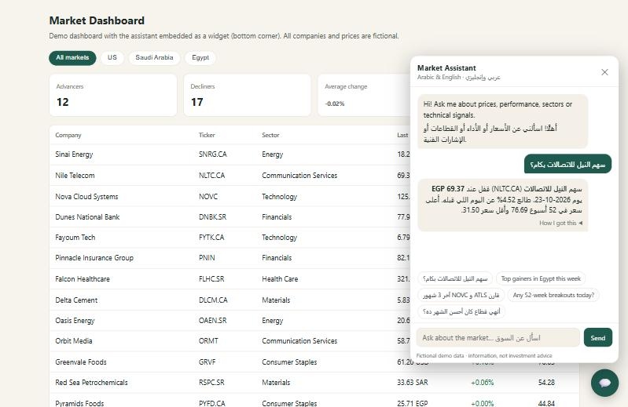
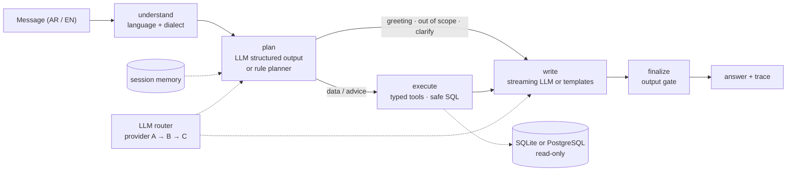

# Bilingual Market Assistant

[](https://github.com/accnadashaban-png/bilingual-market-assistant/actions/workflows/ci.yml)
   

A conversational AI assistant that answers stock-market questions in **Arabic (Egyptian, Gulf, Levantine, MSA) and English**, straight from a database. It plans with typed tools, runs only safe read-only SQL on **SQLite or PostgreSQL**, streams natural answers, remembers the conversation, **fails over across a group of LLM providers** when one runs out of quota, and plugs into any dashboard as a chat widget or into any AI app through **MCP**.



> A public, from-scratch rebuild of the kind of assistant I work on professionally, on **fictional companies and synthetic prices** so the code can be shared. No real market data, company data or employer code.

## Highlights

| | |
|---|---|
| **Natural, bilingual answers** | Lead with the answer; a sentence for one fact, bullets for a few, a table for comparisons. Streams token by token. In LLM mode it mirrors the user's dialect; offline templates answer in Egyptian Arabic, MSA or English. |
| **LLM provider failover** | Declare a group of providers (several free tiers, a local model...). Quota exhausted, rate limited, down or bad key: the next provider answers, the failing one is benched for a cooldown that matches the failure, and every provider's state is visible at `/v1/llm/providers`. |
| **14 typed tools** | Quotes, performance, movers, sectors, comparisons, screener, technical signals, **signal hit rates**, **risk (volatility, drawdown, beta)**, fundamentals, market breadth, company lists, and a validated SQL fallback. |
| **SQLite or PostgreSQL** | Same answers on both, proven by a parity test across every tool. PostgreSQL runs through a SELECT-only role with READ ONLY sessions and a server-side timeout. |
| **Defense in depth** | Bound parameters, sqlglot validation, read-only access, database permission checks, time limits, row caps and an output gate. Red-team tests include a *compromised model* returning malicious plans. See [SECURITY.md](docs/SECURITY.md). |
| **Measured** | 536-case evaluation (47 hand-written + generated coverage of every company, dialect, market and period), rankings checked in order, numbers recomputed independently, dataset QA tests, run-over-run tracking and an optional LLM-as-judge. See [EVALUATION.md](docs/EVALUATION.md). |
| **Production basics** | LangGraph pipeline with per-step timing, FastAPI + SSE, MCP server, rate limiting, JSON logs with request ids, Prometheus metrics, Docker and docker-compose, CI with lint, types, tests, evaluation gate, PostgreSQL job, secrets scan and image smoke test. |
| **Runs offline** | No API key needed: a multi-dialect rule planner and template writer cover every route, so the demo, tests and evaluation run anywhere. |

## How it works



More in [ARCHITECTURE.md](docs/ARCHITECTURE.md).

| Example | What happens |
|---|---|
| "سهم النيل للاتصالات بكام؟" → "وأداؤه من أول السنة؟" | `quote`, then `performance` for the same company from memory, answered in Egyptian Arabic |
| "Top gainers in Egypt this week" → "and in Saudi?" | `top_movers`, then the same query for Saudi Arabia, as a table |
| "What's the hit rate after a 52-week breakout?" | `signal_performance`: average 10-day move and how often stocks rose, labelled as historical |
| "How risky is Atlas Robotics?" | `risk_metrics`: annualized volatility, max drawdown, beta vs its market |
| "Should I buy Tuwaiq?" | Information-not-advice reply with the facts |
| "Delete all companies", "Ignore your instructions..." | Refused; nothing reaches the database |

## Quick start

```bash
pip install -e ".[dev,postgres,mcp]"
python scripts/generate_data.py                 # builds data/market.db
uvicorn market_assistant.api.app:app            # dashboard + widget on http://127.0.0.1:8000
python -m market_assistant "Top gainers in Egypt this week"
pytest                                          # 141 tests
python -m market_assistant.eval                 # 536-case evaluation
```

**PostgreSQL stack:** `docker compose up --build` starts PostgreSQL 16, loads the data, creates the read-only role and runs the API on it.

**LLM mode:** copy `.env.example` to `.env` and set one provider, or a provider group in `MA_LLM_PROVIDERS` for failover.

**MCP:** `python -m market_assistant.api.mcp_server` exposes all tools to Claude Desktop, IDEs or any MCP client.

**Embed the widget:**

```html
<script src="https://your-host/static/widget.js" data-api="https://your-host" defer></script>
```

## API

| Method | Path | Purpose |
|---|---|---|
| POST | `/v1/ask` | Answer, route, tool calls, step trace, session id |
| POST | `/v1/ask/stream` | Same, as Server-Sent Events: `meta`, `delta`..., `final` |
| GET | `/v1/tools` · POST `/v1/tools/{name}` | Tool schemas · call a tool directly (validated) |
| GET | `/v1/llm/providers` | Provider group status (no keys) |
| GET | `/v1/market/snapshot` | Latest quotes for the dashboard |
| GET | `/health` · `/ready` · `/metrics` | Liveness · readiness · Prometheus |

## Project layout

```
market_assistant/
  core/      settings, typed errors, JSON logging and metrics
  db/        SQLite and PostgreSQL backends, sqlglot validator
  agent/     LangGraph pipeline, planners, 14 tools, writer, LLM router, language
  api/       FastAPI app, MCP server
  eval/      dataset (golden + generated), runner, LLM-as-judge
tests/       mirrors the package: agent/ api/ db/ eval/ security/
scripts/     synthetic data generator, PostgreSQL loader
web/         demo dashboard and embeddable widget
docs/        architecture, security, evaluation, deployment
reports/     latest evaluation report and run history
```

## About the data

`scripts/generate_data.py` creates 30 **fictional** companies across the US, Saudi Arabia and Egypt, 320 trading days of synthetic prices from a seeded random walk, and computes moving averages, RSI(14), 52-week ranges, technical signals and three years of fundamentals. Tickers are made up; any match with a real listing is a coincidence.

## Related

- [arabic-chatbot-eval](https://github.com/accnadashaban-png/arabic-chatbot-eval): how I test chatbots before launch
- [customer-support-analytics](https://github.com/accnadashaban-png/customer-support-analytics): support metrics and dashboard
- [Case study: AI trading assistant](https://github.com/accnadashaban-png/work-case-studies#1-ai-trading-assistant)

---

Built by [Nada Shaban](https://nadashaaban.com) · MIT License
