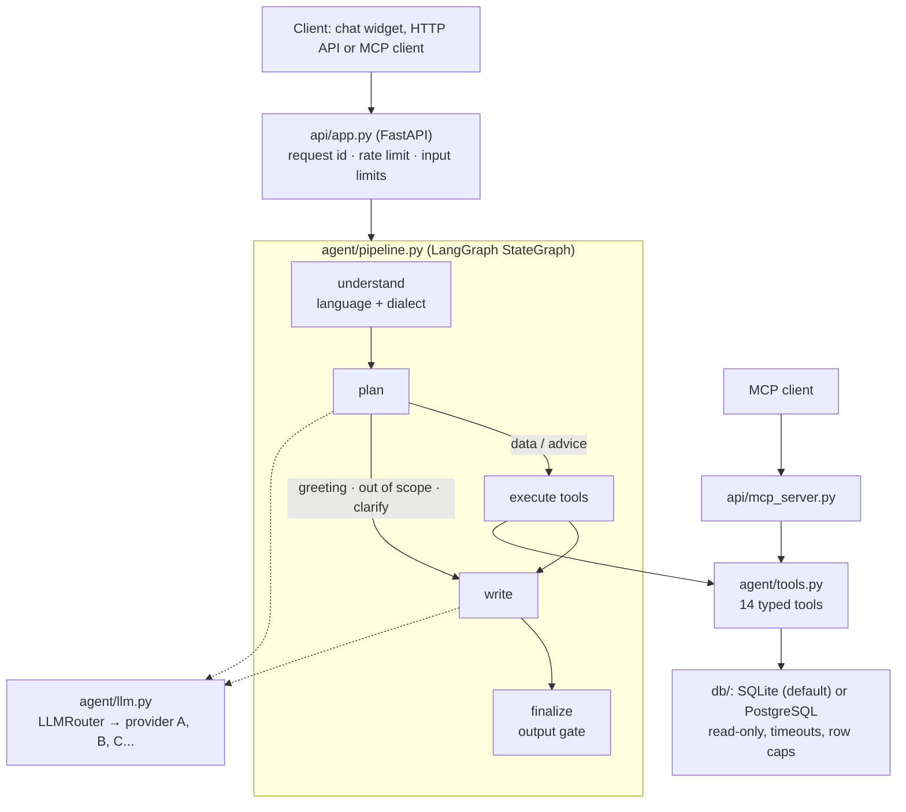

# Architecture

## Request flow

Every node is wrapped with a timer, so each answer carries a `trace` such as
`understand 0.1 ms → plan 120 ms → execute 18 ms → write 0.3 ms → finalize 0.2 ms`.

## Package map

| Package | Module | Responsibility |
|---|---|---|
| `core` | `settings.py` | One Pydantic settings object; env vars with the `MA_` prefix; secrets as `SecretStr`. |
| | `errors.py` | Typed errors, each with a safe message in Arabic and English. |
| | `observability.py` | JSON logs with a request id; Prometheus counters and histograms. |
| `db` | `database.py` | `BaseDatabase` interface, SQLite backend (read-only file, authorizer, time limit), `open_database`. |
| | `postgres.py` | PostgreSQL backend: connection pool, READ ONLY sessions, `statement_timeout`, error mapping. |
| | `sql_safety.py` | sqlglot validator for the `run_sql` fallback, per dialect. |
| `agent` | `pipeline.py` | LangGraph graph, sessions, streaming, step timing. |
| | `planner.py` | `LLMPlanner` (structured output, one repair round) and `RulePlanner` (multi-dialect keywords, memory). |
| | `tools.py` | 14 Pydantic-typed tools; all SQL is parameterized and portable across SQLite and PostgreSQL. |
| | `writer.py` | Answer shapes, LLM writer, output gate. |
| | `llm.py` | OpenAI-compatible client, `LLMRouter` failover, `build_llm`. |
| | `language.py` | Language and dialect detection, Arabic normalization. |
| `api` | `app.py` | FastAPI app: JSON and SSE chat, tools, provider status, health, metrics, static widget. |
| | `mcp_server.py` | MCP server exposing the same tools with the same validation. |
| `eval` | `cases.py`, `runner.py`, `judge.py` | Dataset, runner with run tracking, optional LLM-as-judge. |

## LLM provider failover

`MA_LLM_PROVIDERS` declares an ordered group of OpenAI-compatible providers, for example several free tiers.
`LLMRouter` tries them in order and benches a provider after a failure:

| Failure | Detected from | Cooldown |
|---|---|---|
| Quota exhausted | HTTP 429 with quota/billing wording, or 402 | 1 hour, or `Retry-After` |
| Rate limited | HTTP 429 | `Retry-After`, else 20 s |
| Outage or timeout | HTTP 5xx, connection errors, timeouts | `Retry-After`, else 30 s |
| Bad key | HTTP 401 / 403 | 24 hours |
| Bad request | other 4xx | none, the next provider is tried |

Streaming fails over until the first token arrives; after that it stays with the provider.
If every provider is benched, the call fails fast and the pipeline falls back to the offline planner and writer,
so users still get an answer. `GET /v1/llm/providers` shows each provider's state; keys are never returned.

## Design decisions

- **Typed tools first, free SQL last.** Most questions map to a tool with validated arguments and fixed SQL.
  The model writes SQL only for questions no tool covers, and that SQL is parsed and checked before it runs.
- **Same answers on every backend.** Tool SQL avoids dialect-specific features (boolean sums, unnamed subqueries)
  and every ranking has a deterministic tie-breaker. A parity test runs all tools on SQLite and PostgreSQL.
- **Offline by default.** Without an API key the rule planner and template writer cover every route, so the demo,
  tests and evaluation run anywhere, and an LLM outage degrades quality instead of breaking the service.
- **Stateless HTTP, stateful conversations.** Sessions live in an in-memory store with a TTL behind a small
  interface; swapping it for Redis is the step for running several API replicas.
